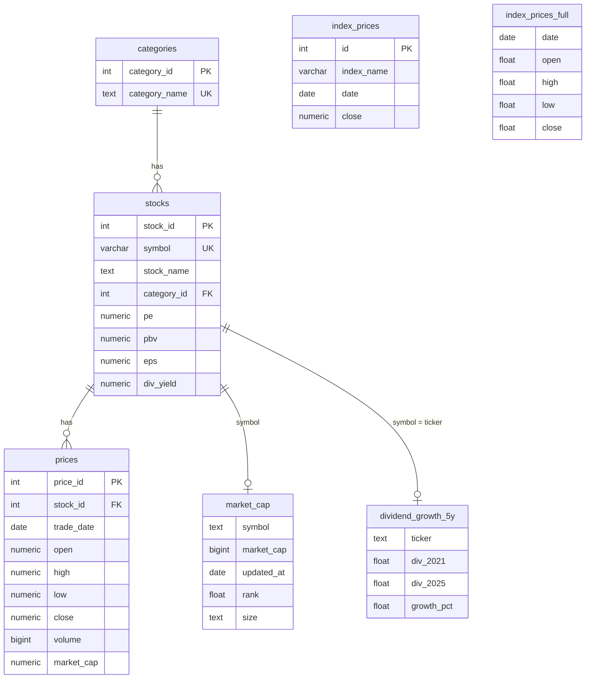

# 📈 Thai Stock Market Analytics

### End-to-End Data Pipeline & Quantitative Analysis for the Stock Exchange of Thailand (SET)


**932 หุ้น · 20 หมวดอุตสาหกรรม · ราคาย้อนหลัง 1 ปี · 40+ หัวข้อการวิเคราะห์**

</div>

---

## 📑 สารบัญ

- [1. ภาพรวม](#1-ภาพรวม)
- [2. ผลลัพธ์สำคัญ](#2-ผลลัพธ์สำคัญ)
- [3. สถาปัตยกรรมระบบ](#3-สถาปัตยกรรมระบบ)
- [4. Tech Stack](#4-tech-stack)
- [5. โครงสร้างโปรเจกต์](#5-โครงสร้างโปรเจกต์)
- [6. Data Model](#6-data-model)
- [7. Pipeline แบบละเอียด](#7-pipeline-แบบละเอียด)
- [8. แคตตาล็อกการวิเคราะห์](#8-แคตตาล็อกการวิเคราะห์)
- [9. Data Quality & Troubleshooting Log](#9-data-quality--troubleshooting-log)
- [10. ข้อจำกัดที่ทราบ](#10-ข้อจำกัดที่ทราบ-known-limitations)
- [11. Quick Start](#11-quick-start)
- [12. Security](#12-security)
- [13. Roadmap](#13-roadmap)
- [14. Disclaimer](#14-disclaimer)

---

## 1. ภาพรวม

โปรเจกต์นี้สร้างระบบข้อมูลหุ้นไทยแบบครบวงจร ตั้งแต่การออกแบบฐานข้อมูล การดึงข้อมูลจากแหล่งภายนอก
การทำความสะอาด ไปจนถึงการวิเคราะห์เชิงปริมาณและการสร้างภาพข้อมูล

**ปัญหาที่แก้:** ข้อมูลหุ้นไทยกระจัดกระจายและไม่มีฐานข้อมูลกลางสำหรับวิเคราะห์ย้อนหลัง
**แนวทาง:** รวบรวมราคา, ข้อมูลพื้นฐาน, Market Cap, ปันผล และดัชนีตลาด เข้าสู่ PostgreSQL ที่เป็นระเบียบ
แล้วตอบโจทย์วิเคราะห์ 5.1 – 5.41 ด้วย SQL + pandas

### ความสามารถหลัก

| | ความสามารถ |
|---|---|
| 🗄️ | ออกแบบ Relational Schema (categories → stocks → prices) พร้อม Foreign Key |
| 🔌 | ดึงข้อมูลอัตโนมัติผ่าน Yahoo Finance (`.BK`) ทั้งราคา ชื่อบริษัท Fundamentals Market Cap ปันผล |
| 🧹 | Data cleaning: จัดการ `Infinity`/`NaN`, ลบ outlier ของดัชนี, UPSERT ป้องกันข้อมูลซ้ำ |
| 📊 | วิเคราะห์ Correlation, Beta, Market Cap Classification, Dividend Growth, Financial Ratios |
| 🕯️ | กราฟ Candlestick / Line / Heatmap แบบ Interactive ด้วย Plotly และ seaborn |

---

## 2. ผลลัพธ์สำคัญ

| ตัวชี้วัด | ผลลัพธ์ |
|---|---|
| หุ้นทั้งหมดในฐานข้อมูล | **932** |
| หมวดหมู่อุตสาหกรรม | **20** |
| Market Cap ที่ดึงได้ / ขาดหาย | **918** / 14 |
| Large Cap (> 100B บาท) | **22** ตัว |
| Mid Cap (20–100B บาท) | **57** ตัว |
| Small Cap (< 20B บาท) | **641** ตัว |
| หุ้นปันผลโตต่อเนื่องทุกปี 2021–2025 | **27** ตัว |
| หุ้นที่ขยับใกล้ SET มากที่สุด | **SINGER** (r = 0.844) · ORI (0.833) · PSH (0.832) |
| คู่หุ้นที่สัมพันธ์กันสูงสุด | **TIDLOR – MTC** (r = 0.892) · SYNTEC – STPI (0.889) · SAWAD – TIDLOR (0.876) |

**หุ้นปันผลโต + Yield สูง (อิงราคาล่าสุด):** MC ≈ 8.81% · NETBAY ≈ 8.73% · TPS ≈ 8.54% · SNNP ≈ 8.22% · LHSC ≈ 8.18%

---

## 3. สถาปัตยกรรมระบบ

```mermaid
flowchart LR
    subgraph SRC[Data Sources]
        A[Yahoo Finance<br/>yfinance]
        B[SETTRADE API<br/>sandbox ❌ 503]
    end

    subgraph ETL[Python ETL]
        C[Extract]
        D[Clean & Transform<br/>pandas / numpy]
        E[Load<br/>SQLAlchemy / psycopg2]
    end

    subgraph DB[(PostgreSQL<br/>thai_stock_market)]
        F[categories]
        G[stocks]
        H[prices]
        I[market_cap]
        J[index_prices /<br/>index_prices_full]
        K[dividend_growth_5y]
    end

    subgraph OUT[Analytics]
        L[SQL + pandas]
        M[Plotly / matplotlib / seaborn]
    end

    A --> C
    B -.ลองแล้วใช้ไม่ได้.-> C
    C --> D --> E --> DB
    DB --> L --> M
```

---

## 4. Tech Stack

| ชั้น | เทคโนโลยี |
|---|---|
| ภาษา | Python 3.9+ |
| ฐานข้อมูล | PostgreSQL |
| Database Access | SQLAlchemy, psycopg2 |
| Data Processing | pandas, numpy |
| Data Source | yfinance (หลัก), settrade-v2 (ทดลอง) |
| Visualization | Plotly, matplotlib, seaborn |
| Environment | Jupyter Notebook |

---

## 5. โครงสร้างโปรเจกต์

```
.
├── 01_dbsetup_api.ipynb                      # สร้าง DB/ตาราง + SETTRADE ชุดที่ 1 + หมวดหมู่
├── 02_dbsetup_api.ipynb                      # SETTRADE ชุดที่ 2
├── 03_dbsetup_to_yfinance.ipynb              # ย้ายมา yfinance: ราคา, Fundamentals, Market Cap
├── 04_yfinance.ipynb                         # โหลดซ้ำ + จัดหมวดหมู่ (map_category)
├── 05_yfinance.ipynb                         # ดัชนี, ปันผลโต 5 ปี, OHLC ของ SET
├── 06__Quantitative_Analysis_for_Stock.ipynb # การวิเคราะห์ 5.1 – 5.41
└── README.md
```

| Notebook | บทบาทใน Pipeline |
|---|---|
| **01** | Setup — สร้าง database, ตาราง, 20 หมวด, ทดลอง SETTRADE |
| **02** | Extract (ทดลอง) — ดึงหุ้นชุดที่ 2 ผ่าน SETTRADE |
| **03** | Extract/Load — pivot แหล่งข้อมูลเป็น yfinance, ใส่ราคา/Fundamentals/Market Cap |
| **04** | Transform — rule-based categorization |
| **05** | Enrich — ดัชนีตลาด และ Dividend Growth |
| **06** | Analyze — Query, สถิติ, กราฟ |

---

## 6. Data Model



**ตารางเสริม:** `missing_market_cap` (14 หุ้นที่ไม่มี Market Cap) · `temp_fund`, `temp_market_cap` (ตารางพักสำหรับ bulk `UPDATE … FROM`)

---

## 7. Pipeline แบบละเอียด

### Phase 1 — Database Setup *(Notebook 01)*
1. เชื่อม PostgreSQL (`autocommit`) แล้ว `CREATE DATABASE thai_stock_market`
2. สร้างตาราง `categories`, `stocks`, `prices` พร้อม FK และ constraint `UNIQUE(symbol)`
3. ตรวจ schema ผ่าน `information_schema`
4. Seed ตาราง `categories` 20 หมวด: Agro & Food, Food & Beverage, Energy & Utilities, Banking, Finance & Securities, ICT, Commerce, Property Development, Construction Services, Construction Materials, Transportation & Logistics, Tourism & Leisure, Health Care, Media, Packaging, Industrial Materials & Machinery, Automotive, Insurance, REIT & Property Fund, MAI / Others

### Phase 2 — Source Evaluation: SETTRADE API *(Notebook 01–03)*
- เชื่อมด้วย `settrade-v2` (โหมด SANDBOX) และดึงแท่งเทียนรายวัน `get_candlestick(interval="1d", limit=260)`
- ข้อจำกัด: ไม่มี `get_security_list` ต้องเตรียมรายชื่อหุ้นเอง จึงแบ่งดึง 2 ชุด (`2S`→`CRC`, `CRD`→`LEO`)
- **ผล:** sandbox ตอบ `HTTP 503 Service Unavailable` → **ตัดสินใจย้ายมาใช้ Yahoo Finance**

### Phase 3 — Price Ingestion *(Notebook 03, 04)*
1. เติมท้ายสัญลักษณ์ด้วย `.BK`
2. `yf.download(tickers, period="1y", group_by="ticker")` ดึงเป็น batch เดียว
3. แปลง MultiIndex → long format, เปลี่ยนชื่อคอลัมน์ให้ตรง schema, map `symbol → stock_id`
4. ตรวจ NULL → `to_sql("prices", if_exists="append")`

### Phase 4 — Company Master Data *(Notebook 01–05)*
- ดึง `longName` / `shortName` จาก `Ticker.info` (fallback เป็น symbol)
- บันทึกด้วย **UPSERT** (`ON CONFLICT (symbol) DO UPDATE`) → รันซ้ำได้ปลอดภัย

### Phase 5 — Fundamentals *(Notebook 03)*
- เก็บ `trailingPE`, `priceToBook`, `trailingEps`, `dividendYield` ของ 932 หุ้น พร้อม rate-limit guard (`sleep` ทุก 50 ตัว)
- Clean: `to_numeric(coerce)` → `±inf → NaN` → `NaN → None` → bulk update ผ่านตาราง `temp_fund`

### Phase 6 — Market Cap *(Notebook 03)*
- ดึงเป็น batch ละ 50 ตัว (`yf.Tickers` + `tqdm`)
- แยก valid (918) / invalid (14) → จัดอันดับ + แบ่งขนาดด้วย `pd.qcut`
- บันทึก `market_cap`, `missing_market_cap` และ `UPDATE prices` ผ่าน JOIN

### Phase 7 — Categorization *(Notebook 04)*
- `map_category()` แบบ rule-based (รายชื่อตรงตัว + prefix + คีย์เวิร์ด `REIT`/`PF`) → default เป็น `MAI / Others`
- `execute_batch` UPDATE `stocks.category_id`

### Phase 8 — Market Indices *(Notebook 05)*
- ดึง `^SET.BK`, `^SET50.BK`, `^SET100.BK` → `index_prices` (`UNIQUE(index_name, date)`)
- ลบ outlier (`close > 5000` และวันที่ `2026-04-07`) → SET 239 / SET50 238 / SET100 238 แถว
- ดึง OHLC ของ SET (2024-01-01 → 2026-04-08) → `index_prices_full` สำหรับ Candlestick

### Phase 9 — Dividend Growth Screening *(Notebook 05)*
- สแกนทั้ง 932 หุ้นจาก `Ticker.dividends` → รวมรายปี 2021–2025
- **เกณฑ์:** มีข้อมูลครบ 5 ปี **และ** ปันผลเพิ่มขึ้นทุกปี → ผ่าน **27 หุ้น** → `dividend_growth_5y`
- สูงสุด: CCET (+723%), LHSC (+666%), KTB (+618%), TPS (+600%), SNNP (+500%)

### Phase 10 — Quantitative Analysis *(Notebook 06)*
ดูหัวข้อถัดไป

---

## 8. แคตตาล็อกการวิเคราะห์

| ข้อ | หัวข้อ | เทคนิค |
|---|---|---|
| 5.1–5.5 | จำนวนหุ้น / รายชื่อ / หมวดหมู่ / หุ้นในแต่ละหมวด | SQL `COUNT`, `JOIN` |
| 5.6–5.9 | Market Cap สูงสุด–ต่ำสุด และการเรียงลำดับ | `JOIN market_cap`, ฟอร์แมตหน่วย "ล้านล้าน/พันล้านบาท" |
| 5.10, 5.27 | Correlation Heatmap (Top 20 Market Cap / Top 20 correlated) | daily returns + `seaborn.heatmap` (mask สามเหลี่ยม) |
| 5.11–5.12 | หุ้นราคาต่ำสุด/สูงสุด | `idxmin` / `idxmax` |
| 5.13–5.22 | SET / SET50 / SET100 / MAI (normalize Base 1000) | indexing + กราฟรายตัวและกราฟรวม |
| 5.23–5.24 | Performance แยกตามหมวด (Base 100, MA 21 วัน) | median รายหมวด + rolling mean |
| 5.25–5.26 | หุ้นที่ขยับใกล้ SET มากที่สุด | correlation เทียบ market proxy |
| 5.28 | "Twin pairs" — คู่หุ้นที่ correlation สูงสุด | `unstack` + dedupe คู่สลับ |
| 5.29–5.30 | Dividend Yield Leaderboard | SQL `ORDER BY div_yield DESC` |
| 5.31–5.32 | หุ้นปันผลโต 5 ปี (เรียง max→min) | query `dividend_growth_5y` |
| 5.33 | Candlestick / Line chart (SET และรายหุ้น) | Plotly `Candlestick`, `Scatter` |
| 5.34–5.35 | จัดกลุ่มตาม Market Cap: Large / Mid / Small | `CASE WHEN` + `DISTINCT ON` |
| 5.34–5.35 | ROE, D/E, P/E ของหุ้นปันผลโต + Financial Health Map | yfinance `.info`, Plotly scatter |
| 5.36–5.37 | จัดกลุ่มตาม Dividend Yield: High ≥ 5% / Moderate 2–5% / Low < 2% | bar + pie |
| 5.40–5.41 | หุ้นที่เหวี่ยงแรงกว่าตลาด (Beta > 1) และการจัดอันดับ | `cov(stock, market) / var(market)` |

**เกณฑ์ตีความที่ใช้:**

| ตัวชี้วัด | เกณฑ์น่าสนใจ |
|---|---|
| ROE | > 15% |
| D/E | < 1.0 |
| P/E | < 15–20 |
| Dividend "Sweet Spot" | Yield > 5% และ P/E < 15 |
| Dividend "Warning" | Yield > 15–20% (ตรวจปันผลพิเศษ/ราคาร่วง) |
| Correlation | ≥ 0.7 ขยับตามกัน · −0.2 ถึง 0.2 ไม่สัมพันธ์ · ≤ −0.7 สวนทาง |

---

## 9. Data Quality & Troubleshooting Log

| # | ปัญหา | วิธีแก้ |
|---|---|---|
| 1 | SETTRADE sandbox ล่ม (503) และไม่มี `get_security_list` | เปลี่ยนแหล่งข้อมูลเป็น yfinance + เตรียมรายชื่อหุ้นเอง |
| 2 | Insert ซ้ำชน `UNIQUE(symbol)` | UPSERT (`ON CONFLICT DO UPDATE`) |
| 3 | `Infinity` / `NaN` จาก yfinance ปนเข้า PostgreSQL | coerce → แทน inf → `None` → bulk update ผ่านตาราง temp |
| 4 | `astype(int64)` พังเพราะ Market Cap เป็น NaN | แยก `df_valid` / `df_invalid` ก่อนแปลงชนิด |
| 5 | Symbol มีเครื่องหมายคำพูด / `.BK` ซ้ำ → 404 | `strip` + `replace` + `set()` แล้วเติม `.BK` ใหม่ |
| 6 | MultiIndex columns ของดัชนี | flatten columns ก่อนเลือกคอลัมน์ |
| 7 | ค่าดัชนีผิดปกติ (close > 5000, วันที่ 2026-04-07) | `DELETE` ออกจาก `index_prices` |
| 8 | ขาด Open/High/Low วาด Candlestick ไม่ได้ | สร้าง `index_prices_full` จาก Yahoo |
| 9 | `date` เป็น reserved word | quote เป็น `"date"` |
| 10 | หมวด Banking ทำสเกลกราฟเพี้ยน (~25,000%) | พล็อตเฉพาะ Index < 1000 และจำกัดแกน Y 0–400 |
| 11 | Rate limit ของ yfinance | batch 50 ตัว + `sleep` |
| 12 | ข้อมูลซ้ำใน `pivot_table` | `aggfunc="median"` + `ffill()` |

---

## 10. ข้อจำกัดที่ทราบ (Known Limitations)

> ข้อสังเกตจากการตรวจโค้ดใน Notebook ควรพิจารณาก่อนนำผลไปใช้ต่อ

1. **Snapshot data:** PE/PBV/EPS/Dividend Yield และ Market Cap เป็นค่า ณ วันที่ดึง ไม่ใช่ข้อมูลย้อนหลัง
2. **`prices.market_cap` ไม่ใช่รายวัน:** ใช้ Market Cap ล่าสุดค่าเดียวเติมทุกแถวของหุ้นนั้น
3. **Categorization แบบ prefix:** อาจจัดผิด เช่น prefix `SC` ตรวจในกลุ่ม Property ก่อน Construction Materials จึงอาจทำให้ `SCC`, `SCG` ถูกจัดเป็น Property; หุ้นที่ไม่ตรงกฎลงหมวด `MAI / Others` ทั้งหมด
4. **MAI Index เป็นค่า proxy:** เมื่อไม่มีข้อมูล โค้ดใช้ `SET × 0.7` — กราฟ MAI จึงไม่ใช่ข้อมูลจริง
5. **"SET Index" ในข้อ 5.25–5.28 เป็นค่าเฉลี่ย return ของทุกหุ้น (equal-weight)** ไม่ใช่ `^SET.BK` จริง
6. **ข้อ 5.40–5.41 คำนวณ Beta** แทนการนับครั้งที่หุ้นขยับเกิน ±1% ตามคำอธิบายหัวข้อเดิม
7. **Coverage gap:** บางหุ้นไม่มีข้อมูลบน Yahoo (เช่น `WELL.BK` ตอบ 404) จึงหายจากการวิเคราะห์
8. **ปันผลรายปี** รวมจาก yfinance — ปันผลพิเศษหรือปีที่จ่ายไม่ครบอาจทำให้ผลคัดกรองต่างจากความจริง
9. **ไม่มี unique key บน `prices`:** รัน `append` ซ้ำจะเกิดข้อมูลซ้ำ ควรเพิ่ม `UNIQUE (stock_id, trade_date)`
10. หมายเลขข้อใน Notebook 06 มีการใช้ซ้ำในบางหัวข้อ (5.32–5.35)

---

## 11. Quick Start

**Prerequisites:** Python 3.9+, PostgreSQL (port 5432), Jupyter

```bash
# 1) ติดตั้งไลบรารี
pip install psycopg2-binary pandas numpy sqlalchemy yfinance settrade-v2 \
            matplotlib seaborn plotly tqdm

# 2) ตั้งค่า credentials ผ่าน environment variables
export PG_USER=postgres
export PG_PASSWORD=<your_password>
export PG_HOST=localhost
export PG_PORT=5432
export PG_DB=thai_stock_market
```

```python
import os
from sqlalchemy import create_engine

engine = create_engine(
    f"postgresql+psycopg2://{os.environ['PG_USER']}:{os.environ['PG_PASSWORD']}"
    f"@{os.environ['PG_HOST']}:{os.environ['PG_PORT']}/{os.environ['PG_DB']}"
)
```

**ลำดับการรัน**

| ขั้น | Notebook | หมายเหตุ |
|---|---|---|
| 1 | `01_dbsetup_api` | รันเฉพาะส่วนสร้าง DB / ตาราง / categories (ข้ามส่วน SETTRADE) |
| 2 | `03_dbsetup_to_yfinance` | ราคา, ชื่อบริษัท, Fundamentals, Market Cap |
| 3 | `04_yfinance` | จัดหมวดหมู่หุ้น |
| 4 | `05_yfinance` | ดัชนี, Dividend Growth, OHLC ของ SET |
| 5 | `06__Quantitative_Analysis_for_Stock` | วิเคราะห์และกราฟ |

> `02_dbsetup_api` เป็นการทดลองดึงผ่าน SETTRADE ไม่จำเป็นต้องรันซ้ำ

**Sanity check**

```sql
SELECT COUNT(*) FROM stocks;             -- 932
SELECT COUNT(*) FROM categories;         -- 20
SELECT index_name, COUNT(*) FROM index_prices GROUP BY index_name;
SELECT COUNT(*) FROM dividend_growth_5y; -- 27 (ขึ้นกับวันที่รัน)
```

---

## 12. Security

⚠️ Notebook ต้นฉบับมี **credentials ฝังอยู่ในโค้ด** (SETTRADE `APP_SECRET` และรหัสผ่าน PostgreSQL หลายค่า)

ก่อน push ขึ้น GitHub หรือแชร์:

- [ ] ขอ **`APP_SECRET` ใหม่** จาก SETTRADE (ค่าเดิมเคยอยู่ในไฟล์แล้ว)
- [ ] เปลี่ยนรหัสผ่าน PostgreSQL
- [ ] ย้ายค่าทั้งหมดไป `.env` / environment variables และเพิ่ม `.env` ใน `.gitignore`
- [ ] ล้าง output: `jupyter nbconvert --clear-output --inplace *.ipynb`
- [ ] ใช้ parameterized query แทน f-string ใน SQL (เช่น query ที่รับชื่อหุ้น)

---

## 13. Roadmap

- [ ] ดึง **MAI Index จริง** แทน proxy และใช้ `^SET.BK` เป็น benchmark ในการคำนวณ correlation/beta
- [ ] เก็บ snapshot Fundamentals / Market Cap เป็นรายวัน เพื่อสร้างข้อมูลย้อนหลังเอง
- [ ] จัดหมวดหมู่จากข้อมูลอุตสาหกรรมทางการของ SET แทน rule-based
- [ ] เพิ่ม `UNIQUE (stock_id, trade_date)` และทำ pipeline เป็น idempotent upsert
- [ ] Orchestration อัตโนมัติ (Airflow / cron)
- [ ] Dashboard (Streamlit / Dash / Metabase)
- [ ] Technical indicators (RSI, MACD, MA) และ backtesting กลยุทธ์ปันผลโต

---

## 14. Disclaimer

โปรเจกต์นี้จัดทำเพื่อการศึกษาและการวิเคราะห์ข้อมูลเท่านั้น **ไม่ใช่คำแนะนำในการลงทุน**
ข้อมูลมาจาก Yahoo Finance ซึ่งอาจไม่ครบถ้วนหรือคลาดเคลื่อน ผู้ใช้ควรตรวจสอบกับแหล่งข้อมูลทางการของ
ตลาดหลักทรัพย์แห่งประเทศไทย (SET) ก่อนตัดสินใจลงทุน

---

**Analysis for Stock Exchange of Thailand (SET)**
Python · PostgreSQL · SQLAlchemy · yfinance · Plotly · pandas
